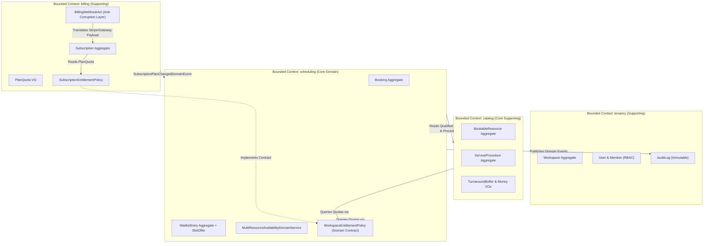
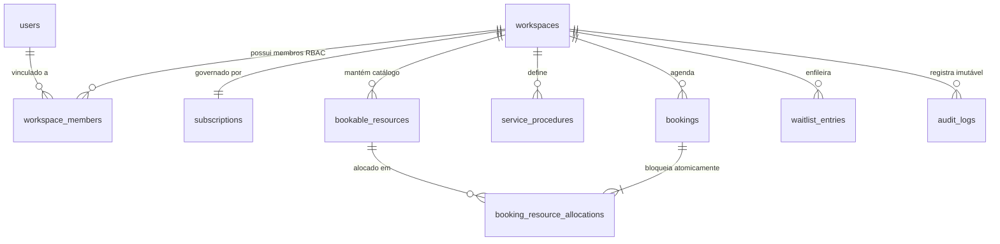

# SlotMatrix — Alocação Multi-Recurso, Proteção Anti-No-Show & Smart Waitlist B2B SaaS

> **ISW055 · Atividade 9 · Fork e Plano de Negócio**  
> **ISW055 · Atividade 10 · Seu Negócio no Ar (Transição de Domínio)**  
> **Orientador:** Professor [@siriani](https://github.com/siriani)  
> **Autor:** Lucas Tetsuya Hiratuca  
> **Repositório do Produto:** [LucasHiratuca/slotmatrix](https://github.com/LucasHiratuca/slotmatrix)  
> *(Continuação direta da disciplina a partir do histórico de [LucasHiratuca/Entrega-da-Atividade](https://github.com/LucasHiratuca/Entrega-da-Atividade))*

---

## 1. Nome e Frase

**SlotMatrix** — Plataforma SaaS B2B de agendamento multi-recurso atômico com proteção financeira anti-no-show e lista de espera inteligente para clínicas diagnósticas, centros cirúrgicos e operações críticas.

---

## 2. A Dor

* **Quem sofre:** Diretores clínicos, coordenadores de enfermagem e gestores de centros médicos ambulatoriais, clínicas de imagem/diagnóstico e estúdios especializados.
* **Quando:** No momento em que um procedimento de alta complexidade necessita da **convergência obrigatória e pontual de múltiplos recursos escassos** (ex.: Médico Especialista + Sala Cirúrgica/Estéril com higienização + Equipamento de R$ 500.000 como Ultrassom Doppler ou Laser).
* **Quanto custa hoje:**
  * **Financeiro:** Ociosidade de salas e equipamentos custa entre **R$ 8.000 e R$ 25.000 por mês** por unidade. O índice médio de no-show (faltas sem aviso prévio) no setor é de 18% a 22%, destruindo a margem operacional.
  * **Tempo:** Equipes de recepção gastam em média **3 horas diárias** confirmando horários no WhatsApp e telefonando manualmente para pacientes na tentativa de preencher desistências de última hora.
  * **Risco Operacional e Sanitário:** Agendas convencionais geram *double-booking* de equipamentos e ignoram tempos de assepsia/esterilização entre exames, expondo o estabelecimento a contaminações cruzadas e penalidades da vigilância sanitária.
* **Como resolvem hoje:** Usam uma colcha de retalhos: prontuários eletrônicos com agendas individuais de médicos isoladas (Doctoralia/Feegow), combinados com planilhas Excel paralelas para controlar quem pegou qual máquina, e cadernos de papel ou grupos de WhatsApp para listas de espera.

---

## 3. Persona

* **Nome:** Dra. Renata Silveira, 42 anos.
* **Perfil e Rotina:** Médica radiologista e sócia-diretora da *VitaScan Diagnósticos* (clínica em Marília/SP com 4 salas de exames e 12 funcionários). Sua rotina se divide entre laudar exames complexos e apagar incêndios administrativos.
* **O que ela tenta fazer:** Maximizar a ocupação dos 3 aparelhos de ultrassom de alta resolução e garantir que as salas cirúrgicas ambulatoriais nunca fiquem ociosas, mantendo rigoroso controle sanitário de 20 minutos de desinfecção entre biópsias.
* **O que atrapalha:** Pacientes faltam de surpresa em procedimentos caros (prejuízo de R$ 600 cada); secretárias agendam dois médicos no mesmo horário para usar a mesma sala; quando alguém cancela às 08h da manhã, o horário das 09h fica vago porque a secretária não tem tempo de ligar para os 15 pacientes que queriam aquela vaga.

---

## 4. Concorrentes e Alternativas

1. **Doctoralia / Feegow / Clinab:**
   * *O que fazem mal:* São agendas focadas **estritamente no profissional de saúde** (médico). Não possuem o conceito de alocação atômica multi-recurso: agendam o médico mas não reservam o equipamento ou a sala cirúrgica simultaneamente, provocando colisões físicas graves. Não oferecem lista de espera inteligente com oferta temporizada.
2. **Planilhas Excel + Grupos de WhatsApp:**
   * *O que fazem mal:* 100% manuais, sem concorrência atômica (*race conditions* constantes), sem validação de regras de sanitização (`TurnaroundBuffer`), sem cobrança automatizada de sinal garantidor e vulneráveis a erros de digitação humana.
3. **Agendadores Genéricos (Calendly / Acuity Scheduling / Google Agenda):**
   * *O que fazem mal:* Desenhados para reuniões individuais de escritório ou consultoria remota de 1-para-1. Não suportam alocação de 3 categorias distintas com tempos assimétricos de limpeza (`prepMinutes` e `cleanupMinutes`), nem políticas B2B de cancelamento com retenção de percentual no Stripe.

---

## 5. Proposta de Valor

> *"Alocação atômica e simultânea de Especialista, Sala e Equipamento sem conflitos, com cobrança automática de sinal anti-no-show e recuperação autônoma de vagas ociosas via Smart Waitlist em minutos."*

---

## 6. Modelo de Receita com Stripe

O faturamento é recorrente mensal (**SaaS B2B via Stripe Subscriptions**), baseado no volume de recursos físicos gerenciados e funcionalidades de automação:

| Plano | Preço Mensal | Limites e Direitos do Plano | Público-Alvo e Motivo do Upgrade |
| :--- | :---: | :--- | :--- |
| **STARTER** | **R$ 149,00 / mês** | • Até **5 recursos alocáveis** ativos (`SPECIALIST`, `ROOM`, `EQUIPMENT`)<br>• Até 150 agendamentos/mês<br>• Alocação multi-recurso básica<br>• Portal de agendamento online<br>*(Smart Waitlist e Sinal Anti-No-Show DESATIVADOS)* | Pequenos consultórios e estúdios em fase inicial. Dá previsibilidade de agenda. |
| **PRO** *(Principal)* | **R$ 349,00 / mês** | • Até **20 recursos alocáveis** ativos<br>• Agendamentos **ILIMITADOS**<br>• **Buffers assimétricos de esterilização** (`TurnaroundBuffer`)<br>• **Proteção Anti-No-Show** (cobrança de sinal e retenção de penalidade no Stripe)<br>• **Smart Waitlist Ativa** (oferta em cascata com expiração de 30 min via BullMQ) | Clínicas de médio porte e centros diagnósticos. O plano se paga recuperando **uma única falta** evitada por mês. |
| **ENTERPRISE** | **R$ 890,00 / mês** | • Recursos e agendamentos **ILIMITADOS**<br>• Multi-unidades / Multi-workspace<br>• Webhooks assinados customizados (HMAC-SHA256)<br>• Exportação de **AuditLog Imutável** para auditorias ISO e vigilância sanitária<br>• Suporte prioritário com SLA de 4h | Redes de policlínicas e hospitais-dia com alta exigência de conformidade e auditoria. |

---

## 7. Métricas de Sucesso

1. **MRR (Monthly Recurring Revenue):** Meta de atingir **R$ 15.000,00** de MRR em 6 meses (~45 clientes PRO).
2. **Taxa de Retenção e Churn:** Churn mensal inferior a **2,0%**, ancorado no fato de que o sistema se torna o coração operacional da clínica.
3. **Taxa de Recuperação de Horários Vagos:** Mais de **65% dos horários cancelados** preenchidos automaticamente pela Smart Waitlist em até 2 horas.
4. **Queda no Índice de No-Show:** Redução das faltas de **18% para menos de 4%** com o sinal caução via Stripe.

---

## 8. Lean Canvas (9 Blocos)

| Bloco | Conteúdo para o SlotMatrix |
| :--- | :--- |
| **1. Problema** | • Colisão de agendas e *double-booking* de salas cirúrgicas e equipamentos de alto custo.<br>• Prejuízo massivo com no-show (18% a 22% de ociosidade não remunerada).<br>• Vagas canceladas em cima da hora que ficam ociosas por lentidão na confirmação manual via WhatsApp.<br>• *Alternativas atuais:* Planilhas Excel, Doctoralia, prontuários sem trava de equipamento, telefone manual. |
| **2. Segmentos de Clientes** | • Clínicas de diagnóstico por imagem e ultrassonografia.<br>• Centros cirúrgicos ambulatoriais e clínicas de cirurgia plástica/dermatológica.<br>• Laboratórios de fisioterapia e estúdios especializados com salas de máquinas.<br>• *Early Adopters:* Clínicas com 2 a 5 salas e equipamentos compartilhados que sofrem com atritos diários de agenda. |
| **3. Proposta Única de Valor** | Alocação atômica multi-recurso com buffers assimétricos de esterilização, proteção financeira anti-no-show e fila de espera inteligente que preenche desistências em cascata sem intervenção humana. |
| **4. Solução** | 1. **Engine de Alocação Concorrente:** Bloqueio atômico com `SELECT ... FOR UPDATE` de Médico + Sala + Máquina respeitando tempos de limpeza.<br>2. **Anti-No-Show no Stripe:** Cobrança de sinal e regras de cancelamento com retenção escalonada.<br>3. **Smart Waitlist em Cascata:** Oferta temporizada com expiração automática (30 min) para o próximo paciente da fila. |
| **5. Canais** | • Parcerias com revendedores e locadores de equipamentos de imagem (GE, Philips, Canon).<br>• Demonstrações guiadas em eventos da Associação Brasileira de Clínicas Médicas.<br>• Tráfego pago focado em termos específicos: *"software agenda centro cirúrgico"*, *"controle de salas e equipamentos clínica"*. |
| **6. Fontes de Receita** | • Assinatura mensal SaaS via Stripe: Plano Starter (R$ 149/mês), Plano Pro (R$ 349/mês) e Plano Enterprise (R$ 890/mês).<br>• Taxa transacional opcional sobre processamento de sinal garantidor anti-no-show. |
| **7. Estrutura de Custos** | • Infraestrutura de nuvem: Servidor Docker/Portainer na Fatec / VPS de produção, instâncias MariaDB e Redis.<br>• Provedor de Object Storage S3 (Garage S3 / MinIO / AWS S3) para documentação e laudos.<br>• Taxas financeiras de gateway (Stripe Checkout). |
| **8. Métricas-Chave** | • MRR e número de Workspaces ativos.<br>• Volume mensal de agendamentos processados.<br>• Valor total de receita salva via retenção de sinal e vagas recuperadas pela Waitlist.<br>• Net Promoter Score (NPS) dos gestores operacionais. |
| **9. Vantagem Injusta** | Algoritmo proprietário de resolução de conflitos simultâneos com buffers assimétricos (`TurnaroundBuffer`) somado à trilha de auditoria imutável por triggers MySQL, difícil de ser reproduzido por prontuários genéricos legados. |

---

## 9. Mapa de Reaproveitamento da Arquitetura

Nenhum serviço ou linha de infraestrutura construído na primeira fase da disciplina foi desperdiçado. A arquitetura de microsserviços foi integralmente reaproveitada e redirecionada para o modelo de negócio:

| Peça do Projeto Anterior (Filmes) | O que vira no SaaS SlotMatrix | Descrição Técnica no Domínio |
| :--- | :--- | :--- |
| **Catálogo de Filmes (TMDB)** | **Catálogo de Recursos e Procedimentos (`catalog`)** | O consumo de filmes dá lugar à modelagem completa de `BookableResources` (`SPECIALIST`, `ROOM`, `EQUIPMENT`) e `ServiceProcedures` com requisitos de competências e tempos de esterilização. |
| **Microsserviço de Login + RBAC** | **Módulo de Tenancy & RBAC (`tenancy`)** | Autenticação JWT com isolamento multi-tenant (`Workspace`) e 4 papéis de negócio rígidos: `OWNER`, `ADMIN`, `COORDINATOR` e `SPECIALIST` com enforcement HTTP 403. |
| **Logs e Auditoria com Redis** | **Barramento de Eventos e Trilha Imutável (`audit`)** | Eventos temporais de auditoria no Redis Streams (`audit:events`) e tabela `audit_logs` blindada por triggers MySQL contra `UPDATE` e `DELETE` para eventos de negócio: agendamento, cancelamento, disparo de oferta e retenção de sinal. |
| **Upload e Perfil (Garage S3 / MinIO)** | **Storage de Laudos e Equipamentos (`storage`)** | O upload de avatares é reaproveitado para anexos do domínio (comprovantes de manutenção de equipamentos, laudos técnicos e guias de autorização médica) via streaming seguro pelo backend. |
| **Plano Premium (Stripe Checkout & Webhooks)** | **Mecanismo de Assinatura B2B & Sinal (`billing`)** | A assinatura mensal vira os planos `STARTER` (R$ 149/mês), `PRO` (R$ 349/mês) e `ENTERPRISE` (R$ 890/mês), processando webhooks assinados (`whsec_...`) e atualizando quotas dinamicamente no banco. |
| **Swagger, Workers e Testes Automatizados** | **OpenAPI 3.0, BullMQ & Vitest** | Documentação interativa Swagger em `/api/docs`, fila BullMQ com Redis para expiração de ofertas de waitlist e 7 suítes completas de testes automatizados com 39 asserções. |

---

## 10. Backlog no GitHub (Roteiro de Desenvolvimento)

Foram estruturadas e planejadas as seguintes issues fundamentais no repositório:

1. **Issue #1: [DOMAIN] Modelar agregados de Recursos, Procedimentos e Alocação Concorrente**
   * *Descrição:* Criar tabelas e agregados de `BookableResource` e `ServiceProcedure` com requisitos por categoria e buffers de higienização.
   * *Critérios de Aceite:* Script `migrations/001_init.sql` funcional com constraints e chaves estrangeiras.
2. **Issue #2: [RBAC] Implementar controle de acesso por papel com 4 perfis clínicos**
   * *Descrição:* Suporte a `OWNER`, `ADMIN`, `COORDINATOR` e `SPECIALIST` no módulo de tenancy.
   * *Critérios de Aceite:* Middleware verificando JWT e respondendo HTTP 403 Forbidden para chamadas não autorizadas.
3. **Issue #3: [SCHEDULING] Algoritmo de bloqueio atômico pessimista e prevenção de Double-Booking**
   * *Descrição:* Implementar `MultiResourceAvailabilityDomainService` com `SELECT ... FOR UPDATE` no MariaDB.
   * *Critérios de Aceite:* Teste de concorrência garantindo que duas reservas simultâneas na mesma sala ou equipamento resultem em HTTP 409 Conflict.
4. **Issue #4: [WAITLIST] Fila de espera inteligente com oferta em cascata e expiração via BullMQ**
   * *Descrição:* Quando um agendamento for cancelado, identificar automaticamente o paciente mais prioritário e emitir `SlotOffer` com expiração de 30 minutos.
   * *Critérios de Aceite:* Se o paciente não confirmar em 30 min, a oferta expira e é repassada ao próximo da fila.
5. **Issue #5: [BILLING] Gestão de assinaturas e quotas com Stripe Webhook**
   * *Descrição:* Endpoint para processamento de webhook do Stripe atualizando estado de subscrição (`ACTIVE`, `TRIALING`, `PAST_DUE`) e limitando criação de recursos conforme a cota do plano.
   * *Critérios de Aceite:* No plano Starter com 5 recursos, tentar cadastrar o 6º dispara HTTP 402 QuotaExceededError.

---

## 11. Arquitetura e Engenharia de Software

### 11.1. Context Map (Domain-Driven Design — 4 Bounded Contexts)



### 11.2. Modelo Entidade-Relacionamento (MariaDB / MySQL)



---

## 12. Credenciais do Seed e Demonstração Operacional

Ao inicializar o sistema (ou rodar `npm run seed`), o banco é provisionado com dois Workspaces configurados para demonstração imediata:

| Workspace | Plano / Status | E-mail de Acesso | Senha | Papel RBAC | Cenário de Demonstração |
| :--- | :--- | :--- | :--- | :--- | :--- |
| **VitaScan Diagnósticos** (`vitascan-diagnosticos`) | `PRO` (`ACTIVE`) | `owner@vitascan.test` | `Passw0rd!` | `OWNER` | **6 Recursos Ativos** (Médicos, Salas Cirúrgicas e Aparelhos de Ultrassom), exames com **buffer de 20 min de desinfecção**, agendamentos ativos e **3 pacientes na Smart Waitlist** prontos para receber oferta em cascata! |
| **VitaScan Diagnósticos** | `PRO` (`ACTIVE`) | `admin@vitascan.test` | `Passw0rd!` | `ADMIN` | Gestão de equipe, catálogo de procedimentos e auditoria. |
| **VitaScan Diagnósticos** | `PRO` (`ACTIVE`) | `coord@vitascan.test` | `Passw0rd!` | `COORDINATOR` | Operação diária: confirmação, check-in, no-show e cancelamentos. |
| **VitaScan Diagnósticos** | `PRO` (`ACTIVE`) | `spec@vitascan.test` | `Passw0rd!` | `SPECIALIST` | Visão da grade clínica (bloqueado com HTTP 403 ao tentar criar recursos ou alterar planos). |
| **Estúdio Aura** (`estudio-aura`) | `STARTER` (`TRIALING`) | `owner@aura.test` | `Passw0rd!` | `OWNER` | Cravado no **limite exato de 5/5 recursos ativos**. Tentar criar o 6º recurso dispara imediatamente `HTTP 402 QuotaExceededError`. |

---

## 13. Como Executar

### Portas dos Serviços
* **MySQL / MariaDB (`slotmatrix_db`):** `localhost:13308`
* **Redis (`slotmatrix_redis`):** `localhost:16381`
* **API HTTP + Swagger (`slotmatrix_api`):** `http://localhost:18081` (Swagger em `http://localhost:18081/api/docs`)
* **Console Web React (`slotmatrix_web`):** `http://localhost:18174`

### Execução via Docker Compose
```bash
docker compose up --build -d
```

### Executar Testes Automatizados (39 Testes em 7 Suítes)
```bash
cd api
npm install
npm test
```
