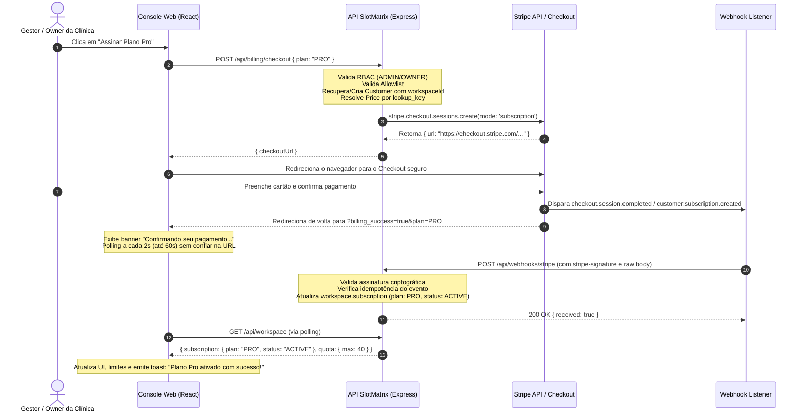

# Arquitetura de Faturamento Recorrente com Stripe (SlotMatrix)

Este documento descreve a arquitetura, configuração, catálogo idempotente, ciclo de vida de webhooks e tratamento de erros do sistema de faturamento recorrente do **SlotMatrix**.

---

## 1. Modelo de Negócio e Planos

O SlotMatrix adota o modelo de **assinatura recorrente mensal em BRL (R$)**:

| Plano | Valor Mensal | Recursos Permitidos | Agendamentos/mês | Features Avançadas | Stripe Mode |
|---|---|---|---|---|---|
| **Starter** | **R$ 0,00** (Gratuito / Trial) | Até 5 recursos | Até 100/mês | Não | Sem produto na Stripe |
| **Pro** | **R$ 349,00 / mês** | Até 40 recursos *(ver nota)* | Ilimitados | Fila inteligente + Sinal 20% | `subscription` |
| **Enterprise**| **R$ 890,00 / mês** | Ilimitados | Ilimitados | Todas + Portal público + Auditoria | `subscription` |

> [!NOTE]
> **Divergência de Quota do Plano Pro**: A documentação textual de negócio inicial citava 20 recursos para o Plano Pro, porém o catálogo de quotas do domínio da API (`PlanQuota`) implementa e devolve **40 recursos**. Essa configuração foi mantida para preservar a integridade do domínio e os testes de regressão existentes, ficando aqui documentada explicitamente.

---

## 2. Variáveis de Ambiente e Segurança

### 2.1 Requisitos de Ambiente (.env)

| Variável | Exemplo de Valor (Modo Teste) | Descrição |
|---|---|---|
| `STRIPE_SECRET_KEY` | `sk_test_51...` | Chave secreta de teste do Stripe Dashboard |
| `STRIPE_PUBLISHABLE_KEY` | `pk_test_51...` | Chave publicável de teste do Stripe |
| `STRIPE_WEBHOOK_SECRET` | `whsec_...` | Segredo retornado pelo `stripe listen` ou endpoint configurado |
| `APP_PUBLIC_URL` | `http://localhost:18174` | URL base do front-end para montagem segura de `success_url`, `cancel_url` e `return_url` |

### 2.2 Hardening e Políticas de Segurança
1. **Bloqueio de Chaves Live (`sk_live_`)**: Fora do ambiente de produção (`NODE_ENV === 'production'`), qualquer chave que inicie com `sk_live_` é terminantemente recusada na inicialização do serviço (`stripe-client.ts`), desativando o billing para evitar qualquer cobrança real involuntária.
2. **Graceful Degradation (503 BILLING_NOT_CONFIGURED)**: Se o Stripe não estiver configurado ou contiver valores de placeholder (`sk_test_demo_...`), a aplicação sobe normalmente. Todas as rotas de billing respondem `503 Service Unavailable` com código estável `BILLING_NOT_CONFIGURED`, e a UI exibe: *"O pagamento ainda não foi configurado nesta instalação. Fale com o administrador."* (nunca 500 nem "Unexpected error").
3. **Imutabilidade de Preços pelo Cliente**: O navegador **nunca** envia preço, valor ou moeda; o front-end envia apenas o identificador do plano (`PRO` ou `ENTERPRISE`), validado por enum/allowlist via Zod. O backend resolve os preços correspondentes via `lookup_key`.
4. **Verificação Criptográfica de Webhooks**: O endpoint `/api/webhooks/stripe` utiliza o corpo cru da requisição (`express.raw({ type: '*/*' })`) registrado **antes** de qualquer parser JSON. Assinaturas HMAC-SHA256 (`stripe-signature`) inválidas ou adulteradas são rejeitadas com status `401 Unauthorized`.
5. **Idempotência**: Toda requisição de criação de Checkout Session utiliza chave de idempotência com prefixo estável por tentativa, e os eventos de webhook são gravados em tabela/conjunto de eventos processados com verificação de timestamp (`current_period_start`/`created`) para evitar corridas ou reprocessamento fora de ordem.

---

## 3. Catálogo Idempotente no Stripe (`stripe:setup`)

Para criar ou sincronizar os produtos e preços mensais no modo de teste do Stripe sem duplicidade, execute na pasta `api`:

```bash
cd api
npm run stripe:setup
```

O script utiliza `lookup_key` estáveis:
- `slotmatrix_pro_monthly` -> Produto "SlotMatrix Pro", R$ 349,00/mês
- `slotmatrix_enterprise_monthly` -> Produto "SlotMatrix Enterprise", R$ 890,00/mês

Se o produto ou preço já existir na conta com a mesma `lookup_key`, o script apenas reutiliza o existente de forma idempotente.

---

## 4. Fluxo de Assinatura e Ciclo de Vida do Webhook



---

## 5. Matriz de Eventos de Webhook

| Evento Stripe | Ação no Domínio | Efeito na Operação da Clínica |
|---|---|---|
| `checkout.session.completed` | Associa `externalCustomerId` e `subscriptionId`; ativa plano (`PRO`/`ENTERPRISE`) e status `ACTIVE`. | Libera nova cota de recursos e agendamentos instantaneamente. |
| `customer.subscription.created` | Registra assinatura e ativa plano de forma idempotente. | Sincroniza vigência da assinatura. |
| `customer.subscription.updated` | Atualiza status (`ACTIVE`, `PAST_DUE`, `CANCELED`) e datas de vigência do período. | Transiciona estado da assinatura conforme o ciclo de faturamento. |
| `customer.subscription.deleted` | Rebaixa o plano imediatamente para `STARTER`. | Dados cadastrados permanecem salvos, porém novos recursos/agendamentos além da cota Starter são bloqueados. |
| `invoice.payment_failed` | Marca assinatura como `PAST_DUE`. | **Bloqueio operacional**: novos agendamentos são impedidos; exibe banner vermelho persistente com atalho para o Customer Portal. |
| `invoice.paid` | Confirma pagamento/renovação; remove `PAST_DUE` se estiver regularizado. | Desbloqueia agendamentos e restaura status `ACTIVE`. |
| Outros / `stripe trigger` | Registra no log estruturado e responde `200 OK`. | Ignorado com segurança (sem alterar dados nem estourar erro 500). |

---

## 6. Códigos de Erro Padronizados (`BILLING_*`)

O front-end e a API nunca expõem texto técnico em inglês ou `Unexpected error`. Todos os erros mapeiam para códigos e mensagens claras em pt-BR com `referenceId` único para suporte:

| Código | HTTP Status | Mensagem ao Usuário |
|---|---|---|
| `BILLING_NOT_CONFIGURED` | 503 | *O pagamento ainda não foi configurado nesta instalação. Fale com o administrador.* |
| `BILLING_PRICE_NOT_FOUND` | 404 | *O preço do plano selecionado não foi localizado no catálogo da Stripe.* |
| `BILLING_ALREADY_SUBSCRIBED` | 409 | *Esta clínica já possui este plano ou um plano superior ativo.* |
| `BILLING_NO_CUSTOMER` | 400 | *Não foi localizado um registro de cliente Stripe associado a esta clínica. Assine um plano primeiro.* |
| `BILLING_PORTAL_NOT_CONFIGURED` | 400 | *O Portal do Cliente da Stripe ainda não está ativado no painel em modo de teste.* |
| `BILLING_STRIPE_UNAVAILABLE` | 502 | *Não foi possível conectar ao serviço de pagamentos no momento. Tente novamente em instantes.* |
| `BILLING_FORBIDDEN` | 403 | *Apenas administradores e proprietários da clínica podem gerenciar assinaturas.* |

---

## 7. Como Testar de Ponta a Ponta (Guia do Desenvolvedor)

### Passo 1: Iniciar o Stripe CLI Listen
Em um terminal dedicado, execute:
```bash
stripe listen --forward-to http://localhost:18081/api/webhooks/stripe
```
Copie o `whsec_...` exibido no terminal para a variável `STRIPE_WEBHOOK_SECRET` no arquivo `.env`.

### Passo 2: Cartões de Teste Oficiais
Utilize os seguintes números no Checkout do Stripe (qualquer validade futura e CVC de 3 dígitos):

| Cenário de Teste | Número do Cartão | Comportamento Esperado |
|---|---|---|
| **Sucesso Imediato** | `4242 4242 4242 4242` | Checkout concluído -> Webhook ativa `PRO` -> Toast no retorno -> Limite sobe para 40 recursos. |
| **Recusa Imediata (Falha)** | `4000 0000 0000 0002` | Stripe recusa no checkout com mensagem amigável; plano do cliente permanece inalterado. |
| **Autenticação 3DS Requerida** | `4000 0000 0000 3155` | Exibe desafio 3D Secure no iframe do Checkout para validação interativa. |

### Passo 3: Ativação do Customer Portal
No painel da Stripe (modo de teste):
1. Acesse **Configurações (Settings) -> Faturamento (Billing) -> Portal do Cliente (Customer Portal)**.
2. Ative as opções de alteração de forma de pagamento, cancelamento e histórico de faturas.
3. Clique em **Salvar alterações**.
