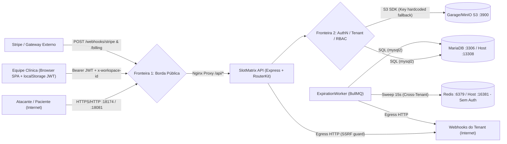

# SlotMatrix — Modelo de Ameaças e Inventário de Superfície de Ataque (Fase A)

**Data:** 2026-11-12  
**Escopo:** Repositório `slotmatrix` (`api/`, `web/`, `docker-compose.yml`, `.env.example`)  
**Status:** Fase A (Reconhecimento e Modelagem de Ameaças — somente análise; nenhuma alteração de código aplicada nesta etapa)

---

## 1. Padrões de Referência (versões verificadas)

- **OWASP Top 10:2025** *(verificado)* — 8ª edição (publicada em novembro de 2025): `A01 Broken Access Control` (inclui SSRF), `A02 Security Misconfiguration`, `A03 Software Supply Chain Failures`, `A04 Cryptographic Failures`, `A05 Injection`, `A06 Insecure Design`, `A07 Authentication Failures`, `A08 Software or Data Integrity Failures`, `A09 Security Logging & Alerting Failures`, `A10 Mishandling of Exceptional Conditions`.
- **OWASP API Security Top 10 (2023)** *(verificado)* — `API1:2023` (BOLA) a `API10:2023` (Unsafe Consumption of APIs).
- **OWASP ASVS 5.0.0** *(verificado)* — Application Security Verification Standard v5.0.0 (lançada em 30 de maio de 2025, substituindo a v4.0.3).
- **LGPD — Lei nº 13.709/2018** *(verificado)* — Art. 5º, II (dado pessoal sensível referente à saúde), Art. 11 (hipóteses restritas de tratamento de dados sensíveis), Art. 46 (medidas técnicas e administrativas de segurança, sigilo e Privacy by Design).

---

## 2. Inventário da Superfície de Ataque

### 2.1. Endpoints HTTP (`api/src/presentation/http/app.ts` e `routes.ts`)

Base prefix para todas as rotas abaixo: `/api` (além de `/api/openapi.json` e `/api/docs`).

| Método | Caminho (`/api...`) | Auth (`access`) | Papel mínimo (`minRole`) | Escopo de Tenant | Entradas / Validação | Observações de Segurança |
| :--- | :--- | :--- | :--- | :--- | :--- | :--- |
| `GET` | `/openapi.json` | Público (`app.ts`) | Nenhum | Global | Nenhuma | Expõe contrato completo sem auth em qualquer `NODE_ENV` |
| `GET` | `/docs` | Público (`app.ts`) | Nenhum | Global | Nenhuma | Swagger UI exposto publicamente em produção |
| `POST` | `/upload` | **Nenhuma** (`app.ts:30`) | Nenhum | **Nenhum** | `multipart/form-data` campo `file` (5 MB) | **CRÍTICO:** Upload anônimo para S3; usa extensão original sem magic bytes |
| `GET` | `/documents/:key(*)` | **Nenhuma** (`app.ts:51`) | Nenhum | **Nenhum** | Path param `key` | **CRÍTICO:** Download anônimo cross-tenant; `Cache-Control: public`; sem `nosniff` |
| `GET` | `/health` | `public` | Nenhum | Global | Nenhuma | Liveness probe |
| `POST` | `/auth/register` | `public` | Nenhum | Cria novo Workspace | `email`, `name`, `password` (min 8), `workspaceName` | Sem rate limit ou política de senha forte além de 8 chars |
| `POST` | `/auth/login` | `public` | Nenhum | Global | `email`, `password` | Sem rate limit / lockout contra brute-force |
| `GET` | `/me/workspaces` | `user` (Bearer JWT) | Autenticado | Lista workspaces do `userId` | Header `Authorization` | Escopado por `userId` do JWT |
| `GET` | `/workspace` | `tenant` | Qualquer membro | `x-workspace-id` | Header `x-workspace-id` | Retorna overview, plano, entitlements e quota |
| `GET` | `/members` | `tenant` | Qualquer membro | `x-workspace-id` | Header `x-workspace-id` | Lista membros (verificar se expõe emails para `SPECIALIST`) |
| `POST` | `/members` | `tenant` | `ADMIN` | `x-workspace-id` | `email`, `role` | `OWNER` protegido contra grant por `ADMIN` no use case |
| `PATCH` | `/members/:userId` | `tenant` | `ADMIN` | `x-workspace-id` | `params.userId`, `body.role` | Alteração de papel no tenant |
| `DELETE` | `/members/:userId` | `tenant` | `ADMIN` | `x-workspace-id` | `params.userId` | Remoção de membro |
| `GET` | `/audit-logs` | `tenant` | `ADMIN` | `x-workspace-id` | Nenhuma | Últimos 200 registros imutáveis |
| `GET` | `/audit-logs/export` | `tenant` | `ADMIN` | `x-workspace-id` | Nenhuma | Exige plano `ENTERPRISE`; até 100.000 logs |
| `GET` | `/resources` | `tenant` | Qualquer membro | `x-workspace-id` | Query `category`, `onlyActive` | Lista especialistas/salas/equipamentos |
| `POST` | `/resources` | `tenant` | `ADMIN` | `x-workspace-id` | `name`, `category`, `capabilities` | Cota verificada fora de lock (`TOCTOU`) |
| `GET` | `/resources/:id` | `tenant` | Qualquer membro | `x-workspace-id` | `params.id` | Detalhe de recurso por tenant |
| `POST` | `/resources/:id/maintenance` | `tenant` | `COORDINATOR` | `x-workspace-id` | `status`, `startAt`, `endAt`, `reason` | Bloqueios de manutenção |
| `GET` | `/procedures` | `tenant` | Qualquer membro | `x-workspace-id` | Nenhuma | Lista procedimentos clínicos |
| `POST` | `/procedures` | `tenant` | `ADMIN` | `x-workspace-id` | `name`, `durationMinutes`, `priceCents`, `depositCents`, `requirements` | Criação de procedimento |
| `GET` | `/procedures/:id/available-slots` | `tenant` | Qualquer membro | `x-workspace-id` | `params.id`, query `from`, `to`, `stepMinutes` | Cálculo multi-recurso com buffers |
| `GET` | `/bookings` | `tenant` | Qualquer membro | `x-workspace-id` | Query `status`, `from`, `to` | **PII/Saúde:** retorna `clientName`, `clientEmail`, `procedureName` |
| `GET` | `/bookings/:id` | `tenant` | Qualquer membro | `x-workspace-id` | `params.id` | **PII/Saúde:** detalhe individual de paciente |
| `POST` | `/bookings` | `tenant` | `COORDINATOR` | `x-workspace-id` | `procedureId`, `startAt`, `clientName`, `clientEmail`, `preferredResourceIds` | Lock `FOR UPDATE` em alocações; cota mensal checada fora de UoW |
| `POST` | `/bookings/:id/confirm-deposit` | `tenant` | `COORDINATOR` | `x-workspace-id` | `params.id` | Confirma sinal financeiro |
| `POST` | `/bookings/:id/check-in` | `tenant` | `COORDINATOR` | `x-workspace-id` | `params.id` | Check-in |
| `POST` | `/bookings/:id/complete` | `tenant` | `COORDINATOR` | `x-workspace-id` | `params.id` | Conclusão do atendimento |
| `POST` | `/bookings/:id/cancel` | `tenant` | `COORDINATOR` | `x-workspace-id` | `params.id`, `body.reason` | Retenção de sinal + gatilho de cascata de lista de espera |
| `POST` | `/bookings/:id/no-show` | `tenant` | `COORDINATOR` | `x-workspace-id` | `params.id` | Marca falta e aplica penalidade |
| `GET` | `/timeline` | `tenant` | Qualquer membro | `x-workspace-id` | Query `date` | **PII/Saúde:** retorna `clientName` em blocos e `waitlistOfferHolds` |
| `GET` | `/dashboard/kpis` | `tenant` | Qualquer membro | `x-workspace-id` | Nenhuma | KPIs operacionais do tenant |
| `GET` | `/waitlist` | `tenant` | Qualquer membro | `x-workspace-id` | Nenhuma | **PII/Saúde:** lista espera com `clientName` e `clientEmail` |
| `POST` | `/waitlist` | `tenant` | `COORDINATOR` | `x-workspace-id` | `procedureId`, `clientName`, `clientEmail`, `desiredStartAt/EndAt`, `priority` | Entrada na lista de espera |
| `POST` | `/waitlist/:id/claim` | `tenant` | `COORDINATOR` | `x-workspace-id` | `params.id` | Aceita oferta de vaga |
| `POST` | `/waitlist/:id/expire-offer` | `tenant` | `COORDINATOR` | `x-workspace-id` | `params.id` | Expira oferta e avança cascata |
| `GET` | `/webhook-channels` | `tenant` | Qualquer membro | `x-workspace-id` | Nenhuma | Verificar se `secret` é mascarado ou retornado |
| `POST` | `/webhook-channels` | `tenant` | `ADMIN` | `x-workspace-id` | `name`, `url` | Valida URL pública contra SSRF (`SafeWebhookUrl` + `assertPublicHostname`) |
| `GET` | `/billing/plans` | `public` | Nenhum | Global | Nenhuma | Tabela pública de planos |
| `POST` | `/webhooks/billing` | `public` (assinado HMAC) | Assinatura `x-billing-signature` | `metadata.workspace_id` | `req.rawBody` + HMAC SHA-256 | Idempotente via `billing_webhook_events`; usa `BILLING_WEBHOOK_SECRET` |
| `POST` | `/billing/simulate` | `tenant` | `OWNER` | `x-workspace-id` | `event`, `plan` | **CRÍTICO:** Ativo sem trava de `NODE_ENV`; permite upgrade gratuito para `PRO`/`ENTERPRISE` |
| `POST` | `/billing/checkout` | `tenant` | `ADMIN` | `x-workspace-id` | `plan` (`PRO`\|`ENTERPRISE`) | Cria sessão Stripe Checkout ou URL mock se `STRIPE_SECRET_KEY` ausente |
| `POST` | `/billing/portal` | `tenant` | `ADMIN` | `x-workspace-id` | Nenhuma | Abre Billing Portal Stripe ou URL mock |
| `POST` | `/webhooks/stripe` | `public` | **Condicional quebrada** | `metadata.workspace_id` / `customer` | `req.rawBody` + header `stripe-signature` | **CRÍTICO:** Se `stripe-signature` for omitido, entra no `else` e aceita JSON sem verificação! |
| `GET` | `/admin/metrics` | `tenant` | `ADMIN` | **Misto (Global + Tenant)** | Header `x-workspace-id` | **ALTO:** Expõe MRR e contagem de assinaturas de TODOS os tenants a qualquer `ADMIN` de clínica |
| `GET` | `/public/book/:slug` | `public` | Nenhum | `params.slug` (PRO/ENTERPRISE) | `slug`, query `date` | DTO sanitizado (sem PII de outros pacientes); enumeração de slugs possível |
| `POST` | `/public/book/:slug/schedule` | `public` | Nenhum | `params.slug` | `procedureId`, `startAt`, `clientName`, `clientEmail` | Sem CAPTCHA / rate limit / verificação de e-mail; permite lock de agenda e DoS |
| `POST` | `/public/book/:slug/waitlist` | `public` | Nenhum | `params.slug` | `procedureId`, `clientName`, `clientEmail`, `desiredStartAt/EndAt` | Sem rate limit / proteção anti-spam |

### 2.2. Filas, Workers e Webhooks

- **BullMQ (`slotmatrix-expiration-sweeps`):** executado em `api/src/main-worker.ts` via `ExpirationWorker` (`api/src/scheduling/infrastructure/ExpirationWorker.ts`) com varredura a cada `15_000` ms sobre Redis (`REDIS_URL`). Realiza operações system-wide cross-tenant para:
  1. Expirar reservas `PENDING_DEPOSIT` vencidas (`findExpiredPendingDepositsSystemWide`);
  2. Expirar `SlotOffer`s vencidas na fila de espera (`findExpiredOffersSystemWide`), disparando cascata automática.
  - *Nota:* Não há uso direto de Redis Streams no código atual; o transporte de fila usa BullMQ sobre Redis.
- **Webhooks de entrada (Billing / Stripe):**
  - `POST /api/webhooks/billing`: verifica assinatura `x-billing-signature` via `hmac-sha256` (`timingSafeEqual`) em `BillingWebhookAcl` e garante idempotência via chave primária `external_event_id` em `billing_webhook_events`.
  - `POST /api/webhooks/stripe`: roteia para `StripeBillingGateway.verifyWebhookSignature` **somente se** `isConfigured()` e `stripeSig` existirem; caso contrário aceita JSON puro no ramo `else` (`routes.ts:697-706`).
- **Webhooks de saída (`WebhookNotificationGateway`):** envia `POST` assinado (`X-SlotMatrix-Signature`, `X-SlotMatrix-Timestamp`) com `redirect: 'manual'`, timeout `5000ms` e validação anti-SSRF/DNS-rebinding (`assertPublicHostname` em `ssrf.ts`), **exceto** quando `ALLOW_LOCAL_WEBHOOKS=true`.

### 2.3. Storage / Buckets (`api/src/shared/infrastructure/s3-storage.ts`)

- Cliente `minio` apontando para `S3_ENDPOINT` (default `garage:3900`), `useSSL: false`, `pathStyle: true`, bucket `slotmatrix-docs`.
- **Problema crítico de credenciais:** `s3-storage.ts:12-13` traz `accessKey` e `secretKey` literais hardcoded como fallback (`GK9ae6...` / `f46bb9...`).
- **Problema crítico de controle de acesso:** `POST /api/upload` grava objetos como `workspace-docs/${randomUUID()}.${ext}` **sem prefixo de tenant, sem autenticação e sem validação de magic bytes**; `GET /api/documents/:key(*)` faz streaming público (`Cache-Control: public, max-age=3600`) de qualquer chave do bucket sem autenticação nem isolamento de tenant.

### 2.4. Infraestrutura e `docker-compose.yml`

| Serviço Compose | Imagem / Build | Portas no Host | Rede | Credenciais / Configurações Observadas |
| :--- | :--- | :--- | :--- | :--- |
| `slotmatrix_db` | `mariadb:11.4` | **`13308:3306`** (exposta em `0.0.0.0`) | default | `MARIADB_USER: slotmatrix`, `MARIADB_PASSWORD: slotmatrix`, `MARIADB_ROOT_PASSWORD: slotmatrix_root` |
| `slotmatrix_redis` | `redis:7-alpine` | **`16381:6379`** (exposta em `0.0.0.0`) | default | **Sem senha / ACL (`requirepass` ausente)** |
| `slotmatrix_api` | `./api` (`node:20-alpine`, user root) | **`18081:18081`** | default | `JWT_SECRET` e `BILLING_WEBHOOK_SECRET` hardcoded no Compose; `AUTO_SEED: "true"`; roda `tsx src/main-api.ts` como `root` |
| `slotmatrix_worker` | `./api` (`node:20-alpine`, user root) | Nenhuma | default | Mesmos segredos hardcoded no Compose; roda `tsx src/main-worker.ts` como `root` |
| `slotmatrix_web` | `./web` (`nginx:1.27-alpine`) | **`18174:80`** | default | Proxy `/api/` -> `slotmatrix_api:18081`; sem headers HTTP de segurança (`CSP`, `X-Frame-Options`, `X-Content-Type-Options`, `Referrer-Policy`) em `web/nginx.conf` |

### 2.5. Variáveis de Ambiente

- **Públicas (build-time front-end `VITE_*`, incorporadas no bundle JS):**
  - `VITE_DEMO_MODE` (`web/src/App.tsx:126` usa `=== 'true'`, porém `web/src/LoginView.tsx:44-45` trata `undefined` como `true`, exibindo contas de demonstração com senha em texto claro `Passw0rd!` por padrão!).
  - `VITE_API_PROXY_TARGET` (somente dev server Vite em `web/vite.config.ts`).
- **Privadas (server-side / infra):**
  - `PORT` (default `18081`), `DATABASE_URL` (default com usuário/senha `slotmatrix:slotmatrix`), `REDIS_URL` (default sem senha), `JWT_SECRET` (fallback hardcoded `'slotmatrix-production-grade-secret-key-2026'`), `BILLING_WEBHOOK_SECRET` (fallback hardcoded `'whsec_slotmatrix_billing_secret_2026'`), `ALLOW_LOCAL_WEBHOOKS`, `AUTO_SEED`, `STRIPE_SECRET_KEY`, `STRIPE_WEBHOOK_SECRET`, `APP_PUBLIC_URL`, `S3_ENDPOINT`, `S3_BUCKET`, `S3_ACCESS_KEY`, `S3_SECRET_KEY`, `S3_REGION`.

### 2.6. Dependências (`api/package.json`, `web/package.json`)

- Ambos os pacotes possuem `package-lock.json` (`api/package-lock.json` e `web/package-lock.json`).
- **Back-end (`api`):** `express ^4.21.0`, `bcryptjs ^2.4.3`, `bullmq ^5.12.0`, `cors ^2.8.5`, `ioredis ^5.4.1`, `jsonwebtoken ^9.0.2`, `minio ^8.0.7`, `multer ^2.5.0`, `mysql2 ^3.11.0`, `stripe ^23.1.0`, `swagger-ui-express ^5.0.1`, `zod ^3.23.8`, `tsx ^4.19.0`.
- **Front-end (`web`):** `react ^18.3.1`, `react-dom ^18.3.1`, `lucide-react ^0.460.0`, `@fontsource/instrument-sans ^5.3.0`; build/test: `vite ^5.4.11`, `playwright ^1.65.0`, `vitest ^2.1.9`, `tailwindcss ^3.4.15`.
- *Observação de verificação:* Análise de CVEs via `npm audit` e scan estático detalhado serão executados na Fase B.

---

## 3. Modelo de Ameaças

### 3.1. Ativos Críticos

1. **Dados Pessoais Sensíveis de Saúde (LGPD Art. 5º II e Art. 11):** Nomes, e-mails, vínculo com procedimentos diagnósticos (ex.: *Eco-Doppler*, exames clínicos), horários de atendimento, faltas (`NO_SHOW`), motivo de cancelamento e possíveis laudos/anexos em S3.
2. **Credenciais e Sessões:** Hashes bcrypt de senhas, tokens JWT (`HS256`, TTL `8h`), segredos de webhook HMAC (`BILLING_WEBHOOK_SECRET`, `STRIPE_WEBHOOK_SECRET`, `webhook_channels.secret`), credenciais S3/MariaDB.
3. **Integridade de Faturamento e Planos (Subscriptions & Entitlements):** Estado da assinatura (`STARTER`/`PRO`/`ENTERPRISE`, `ACTIVE`/`TRIALING`/`PAST_DUE`/`CANCELED`) que controla limites de recursos ativos, cota mensal, sinal financeiro, lista de espera automática e portal público.
4. **Trilha de Auditoria Imutável (`audit_logs`):** Registros protegidos por triggers SQL `BEFORE UPDATE`/`BEFORE DELETE` e exportação restrita ao plano `ENTERPRISE`.
5. **Integridade Operacional da Agenda e Lista de Espera:** Alocação simultânea sem double-booking (Especialista + Sala + Equipamento + buffers de esterilização) e ordem justa da cascata da lista de espera (`SlotOffer`).

### 3.2. Atores e Níveis de Confiança

- **Visitante anônimo / Atacante externo:** Sem credenciais; alcança internet pública (`/api/public/book/:slug`, `/api/webhooks/*`, `/api/docs`, `/api/upload`, `/api/documents/*`, `/api/auth/*` e portas Docker se expostas).
- **Paciente (Portal Público):** Acesso anônimo ao slug da clínica para consultar horários e criar reservas/entrar na fila de espera.
- **`SPECIALIST` (Profissional da clínica):** Autenticado no workspace; papel mínimo (`RANK 1`). Deve ver agenda operacional sem acessar billing, auditoria, webhooks nem gestão de equipe.
- **`COORDINATOR` (Recepção/Coordenação):** `RANK 2`; cria/cancela/check-in/conclui agendamentos e gerencia lista de espera e bloqueios de manutenção.
- **`ADMIN` (Administrador da clínica):** `RANK 3`; gerencia membros (exceto `OWNER`), recursos, procedimentos, webhooks, billing checkout/portal e visualiza auditoria.
- **`OWNER` (Proprietário da clínica):** `RANK 4`; controle total do próprio tenant. **Não** é operador global do SaaS.
- **`OWNER`/`ADMIN` de outro tenant (Inquilino malicioso):** Autenticado legitimamente em seu próprio workspace (`Estúdio Aura`), tentando ler/alterar dados de outro tenant (`VitaScan Diagnósticos`) ou métricas globais da plataforma.
- **Operador da plataforma / Infra:** Acesso ao host Docker, variáveis de ambiente, banco, Redis e storage.

### 3.3. Diagrama de Fluxo de Dados e Fronteiras de Confiança

### 3.4. Análise STRIDE

| Categoria STRIDE | Ameaça Identificada no SlotMatrix | Vetores Observados |
| :--- | :--- | :--- |
| **Spoofing** | Falsificação de JWT com segredo padrão de repositório/Compose (`slotmatrix-production-grade-secret-key-2026`); falsificação de evento Stripe sem assinatura (`POST /webhooks/stripe` sem `stripe-signature`); login com contas de demo pré-populados (`owner@vitascan.test` / `Passw0rd!`). | `docker-compose.yml`, `mysql-infrastructure.ts:37`, `routes.ts:697-706`, `seed.ts`, `LoginView.tsx:44-45` |
| **Tampering** | Bypass de assinatura Stripe para alterar plano de qualquer clínica; uso indevido de `POST /billing/simulate` para auto-upgrade gratuito em produção; sobrescrita/upload de arquivos arbitrários em `/api/upload`; possível corrida de cota (`TOCTOU`) ao criar recursos ou agendamentos simultâneos. | `routes.ts:594-635`, `routes.ts:687-713`, `app.ts:30-49`, `catalog/application/use-cases.ts:34-55` |
| **Repudiation** | Uso de conta demo compartilhada; ausência de rate-limit/log de tentativas de login falhas e falhas de autorização; endpoints `/api/upload` e `/api/documents/*` sem `actorId` nem trilha em `audit_logs`. | `app.ts:30-61`, `routes.ts:88-99`, `exception-filter.ts` |
| **Information Disclosure** | Acesso anônimo a quaisquer anexos em `GET /api/documents/:key(*)` (com `Cache-Control: public`); exposição de MRR e distribuição global de assinaturas de outras clínicas em `GET /api/admin/metrics`; `swagger` e `openapi.json` públicos; segredos S3 fallback em código; segredos JWT/webhook no `docker-compose.yml`; portas DB (`13308`) e Redis (`16381`, sem senha) abertas no host. | `app.ts:24-61`, `routes.ts:715-756`, `s3-storage.ts:12-13`, `docker-compose.yml`, `web/src/App.tsx` (`localStorage` JWT) |
| **Denial of Service** | Flood em `/public/book/:slug/schedule` e `/waitlist` esgotando todos os horários da clínica (`PENDING_DEPOSIT` ou confirmações grátis) sem CAPTCHA/rate limit; upload repetido ilimitado em `/api/upload` anônimo enchendo o bucket S3; bloqueio de conta ou brute-force sem rate limit; CORS irrestrito (`cors()`). | `app.ts:16,30-49`, `routes.ts:770-828` |
| **Elevation of Privilege** | `OWNER` de clínica usando `/billing/simulate` para obter recursos `PRO`/`ENTERPRISE` sem pagar; `ADMIN` de clínica acessando métricas globais da plataforma (`/admin/metrics`); `SPECIALIST` potencialmente acessando e-mails/dados administrativos se rotas GET não segregarem DTO por papel; ataque XSS podendo roubar JWT do `localStorage` (agravado se HTML/SVG for servido inline em `/documents/:key`). | `routes.ts:594-635,715-756`, `app.ts:51-61`, `web/src/App.tsx` |

### 3.5. Casos de Abuso Específicos de Domínio

1. **Abuso de Billing / Fraude de Plano (Bypass de Monetização):** Atacante externo envia `POST /api/webhooks/stripe` **sem cabeçalho `stripe-signature`** com `type: "checkout.session.completed"` e `metadata: { workspace_id: "<alvo>", plan: "ENTERPRISE" }`, ativando plano ilimitado para qualquer clínica; ou `OWNER` legítimo chama `POST /api/billing/simulate` em produção.
2. **Vazamento de Documentos Clínicos / Stored XSS via Storage:** Qualquer pessoa enumera ou intercepta chaves `workspace-docs/<uuid>.<ext>` em `GET /api/documents/:key(*)` sem token; além disso, um atacante anônimo envia um `.html` ou `.svg` via `POST /api/upload` e compartilha o link `/api/documents/...svg` sob a mesma origem (`:18174/api/...`) para executar JavaScript no navegador de funcionários e exfiltrar `slotmatrix_token` do `localStorage`.
3. **Sufocamento de Agenda (Agenda Exhaustion via Portal Público):** Concorrente ou bot envia dezenas de requisições `POST /api/public/book/:slug/schedule` bloqueando todos os especialistas/salas/equipamentos de uma clínica durante semanas sem custo ou desafio anti-automação.
4. **Quebra de Cota de Plano por Condição de Corrida (TOCTOU):** Clínica no plano `STARTER` (4/5 recursos ou 99/100 agendamentos) dispara requisições concorrentes para `POST /api/resources` ou `POST /api/bookings` e ultrapassa o limite do plano antes da gravação no banco.
5. **Sequestro de Infraestrutura por Portas e Segredos Padrão:** Qualquer processo local ou na rede do host acessa Redis (`:16381`, sem senha) para injetar/envenenar jobs BullMQ ou MariaDB (`:13308`, usuário `slotmatrix`/`slotmatrix`) para apagar dados ou ler todos os pacientes; atacante na internet assina JWT válido com `JWT_SECRET` padrão caso a infra use valores do `docker-compose.yml` / fallback.

---

## 4. Critérios de Classificação de Severidade

| Severidade | Critério de Impacto | Critério de Explorabilidade / Contexto | Exemplos no Domínio |
| :--- | :--- | :--- | :--- |
| **Crítica** | Comprometimento total de confidencialidade de dados sensíveis de saúde (LGPD Art. 5º II), quebra de isolamento multi-tenant, fraude financeira direta / ativação arbitrária de plano, execução remota de código / Stored XSS com roubo de sessão admin, ou comprometimento completo de credenciais raiz. | Explorável remotamente sem autenticação ou com autenticação trivial (ex.: conta comum, webhook forjado, upload anônimo, segredo hardcoded em produção). | Bypass de assinatura em `/webhooks/stripe`; `/upload` e `/documents/*` anônimos com XSS same-origin; `JWT_SECRET` hardcoded em produção. |
| **Alta** | Acesso indevido a dados de outros tenants (mesmo agregados comerciais/MRR), escalonamento de privilégio dentro ou fora do tenant, bypass de cota/regras de negócio críticas (billing gratuito por `OWNER`, double-booking), exposição direta de banco/fila sem senha, vazamento de PII para papéis não autorizados. | Requer autenticação de usuário/tenant, acesso à rede adjacente/host, ou exploração sob corrida simples; impacto severo na conformidade LGPD ou receita. | `/billing/simulate` ativo sem guard de ambiente; `/admin/metrics` vazando MRR global; Redis sem senha e portas DB/Redis em `0.0.0.0`; JWT em `localStorage` sem CSP/HttpOnly; TOCTOU em cota/double-booking. |
| **Média** | Exposição de superfície auxiliar (OpenAPI/Swagger em produção), ausência de rate limiting em login/portal público (brute-force/DoS lógico), falta de security headers (`CSP`, `HSTS`, `X-Frame-Options`), `CORS` permissivo, política fraca de senha/sessão sem revogação. | Requer condições adicionais (força bruta, cadeia com outra falha, rede local/browser) ou produz impacto limitado de disponibilidade/enumeração. | `cors()` irrestrito; `/api/docs` público; ausência de rate limit em `/auth/login` e `/public/book/:slug/*`; `VITE_DEMO_MODE` ligado por omissão quando indefinido. |
| **Baixa** | Hardening defensivo sem impacto direto imediato em sigilo/integridade (ex.: container rodando como root sem escape direto, ausência de `.strict()` em payloads Zod secundários, headers informativos). | Difícil exploração isolada; defesa em profundidade. | `Dockerfile` sem usuário `USER node`; validação de complexidade adicional de senha. |
| **Informativa** | Observação arquitetural ou recomendação de boas práticas sem vulnerabilidade explorável confirmada no contexto avaliado. | N/A | Documentação de rotação periódica de chaves e retenção LGPD. |

---

## 5. Verificação Rápida dos 8 Itens Suspeitos (Seção 4 do Escopo)

Resumo factual obtido na leitura direta do código em Fase A (provas dinâmicas, testes automatizados e correções ocorrerão somente após aprovação na Fase B/C):

1. **Botão/endpoint de "ativar plano imediatamente" em Billing/demo (`/api/billing/simulate`):**
   - **CONFIRMADO (Crítico/Alto):** Em `api/src/presentation/http/routes.ts:594-635`, `POST /api/billing/simulate` (`access: 'tenant'`, `minRole: 'OWNER'`) não possui verificação de `NODE_ENV` ou flag de demo; usa o `billingWebhookSecret` do servidor para assinar e aprovar upgrade instantâneo para `PRO` ou `ENTERPRISE` sem pagamento. No front-end (`web/src/BillingView.tsx:461-532`), os botões aparecem incondicionalmente para o usuário sem checar ambiente.
2. **Endpoint de métricas SaaS (`GET /api/admin/metrics`) retornando agregados cross-tenant:**
   - **CONFIRMADO (Alto):** Em `api/src/presentation/http/routes.ts:715-756`, a rota exige apenas `access: 'tenant'` e `minRole: 'ADMIN'` de uma clínica, mas chama `c.infra.subscriptions.countByPlanAndStatus()` (`mysql-repositories.ts:197-208`), que executa `SELECT plan, status, COUNT(*) FROM subscriptions GROUP BY plan, status` **sem filtro de `workspace_id`**, expondo MRR global e contagem de assinaturas de toda a plataforma.
3. **Credenciais de seed, `AUTO_SEED` e `VITE_DEMO_MODE`:**
   - **CONFIRMADO (Alto/Médio):** `docker-compose.yml` define `AUTO_SEED: "true"` no serviço `slotmatrix_api`; `api/src/seed.ts` cria usuários fixos (`owner@vitascan.test`, `admin@vitascan.test`, `coord@vitascan.test`, `spec@vitascan.test`, `owner@aura.test`) com senha única `Passw0rd!`. No front-end, `web/src/LoginView.tsx:43-45` interpreta `VITE_DEMO_MODE === undefined` como **`true`**, exibindo o acordeão de contas demo com credenciais embutidas (`onSubmit('owner@vitascan.test', 'Passw0rd!')`), enquanto `web/src/App.tsx:126` exige explicitamente `'true'`.
4. **Isolamento multi-tenant (`VitaScan` vs `Estúdio Aura` + rotas fora do `RouterKit`):**
   - **PARCIALMENTE PROTEGIDO NO ROUTERKIT / FALHA CRÍTICA NO STORAGE:** Rotas dentro do `RouterKit` exigem `x-workspace-id` e validam `ws.roleOf(userId)` (`router-kit.ts`), e as queries SQL visitadas filtram por `workspace_id`. **Contudo**, `POST /api/upload` e `GET /api/documents/:key(*)` (`app.ts:30-61`) estão registradas **fora do `RouterKit`**, sem autenticação e sem escopo de tenant, permitindo que qualquer visitante anônimo leia documentos de qualquer clínica e suba arquivos arbitrários. Além disso, verificar na Fase B se `SPECIALIST` ou outros papéis podem ler dados excessivos em `/bookings`, `/timeline` ou `/webhook-channels`.
5. **Portas de banco/Redis expostas no host e Swagger/OpenAPI público:**
   - **CONFIRMADO (Alto/Médio):** `docker-compose.yml` publica MariaDB (`13308:3306`) e Redis (`16381:6379` **sem senha**) no host; `api/src/presentation/http/app.ts:24-28` serve `/api/openapi.json` e `/api/docs` (Swagger UI) sem autenticação nem restrição de `NODE_ENV`.
6. **Armazenamento de JWT no browser e TTL/validação do token:**
   - **CONFIRMADO (Alto):** `web/src/App.tsx` e `web/src/ErrorBoundary.tsx` armazenam `slotmatrix_token` (Bearer JWT), `slotmatrix_workspace_id`, `slotmatrix_user_email` e `slotmatrix_user_name` em `localStorage`. Em `api/src/shared/infrastructure/security.ts:15-27`, `JwtTokenService` usa `HS256` com TTL `8h`, sem refresh token/revogação (jti/blacklist no logout) e com `JWT_SECRET` padrão hardcoded em `mysql-infrastructure.ts:37` e `docker-compose.yml`. O risco de `localStorage` escala para roubo de token se combinado com `GET /api/documents/:key(*)` servindo SVG/HTML under same-origin.
7. **Webhook Stripe: verificação com raw body e idempotência:**
   - **FALHA CRÍTICA CONFIRMADA:** `POST /api/webhooks/stripe` (`routes.ts:687-713`) usa `req.rawBody` apenas quando `c.stripeGateway.isConfigured() && stripeSig` são verdadeiros. Se o atacante enviar `POST /api/webhooks/stripe` **omitindo o cabeçalho `stripe-signature`** (ou se `STRIPE_SECRET_KEY` não começar com `sk_`), o fluxo cai no `else` (`routes.ts:703-706`) e executa `JSON.parse(rawBody)` **sem verificar assinatura alguma**, permitindo alterar a assinatura de qualquer tenant! (A idempotência via `billing_webhook_events.external_event_id` existe em `ProcessBillingWebhookUseCase`, assim como a verificação HMAC em `POST /api/webhooks/billing` quando `rawBody` está presente, porém este último também depende do `BILLING_WEBHOOK_SECRET` hardcoded no Compose.)
8. **Race condition de double-booking e cota:**
   - **PARCIALMENTE PROTEGIDO / TOCTOU CONFIRMADO:**
     - *Double-booking:* `ScheduleMultiResourceBookingUseCase` (`scheduling/application/use-cases.ts:103-142`) executa alocação dentro de `uow.run` (`BEGIN...COMMIT`) com `SELECT ... FOR UPDATE` em `booking_resource_allocations` (`mysql-repositories.ts:460-489`). Porém `listActiveOffersByTenant` na mesma função `collectActiveHolds` roda em `Promise.all` sem `FOR UPDATE`, e quando o slot ainda não tem linhas existentes (slot vazio), o lock de gap/intenção de inserção no MariaDB precisa ser testado sob carga concorrente real na Fase B (além de verificar `Waitlist` claim).
     - *Cota (TOCTOU confirmado em código):* Tanto `CreateBookableResourceUseCase` (`catalog/application/use-cases.ts:34-55`) quanto `ScheduleMultiResourceBookingUseCase` (`scheduling/application/use-cases.ts:87-98`) consultam `countActiveByTenant` / `countByTenantInMonth` **fora da transação e sem lock exclusivo**, possibilitando ultrapassar o limite do plano (`5` recursos ou `100` agendamentos/mês no `STARTER`) com requisições simultâneas.
